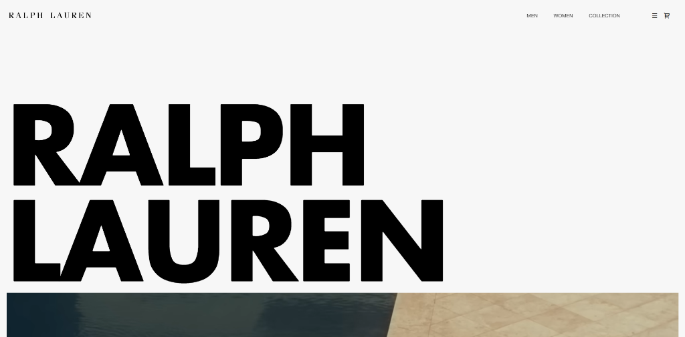
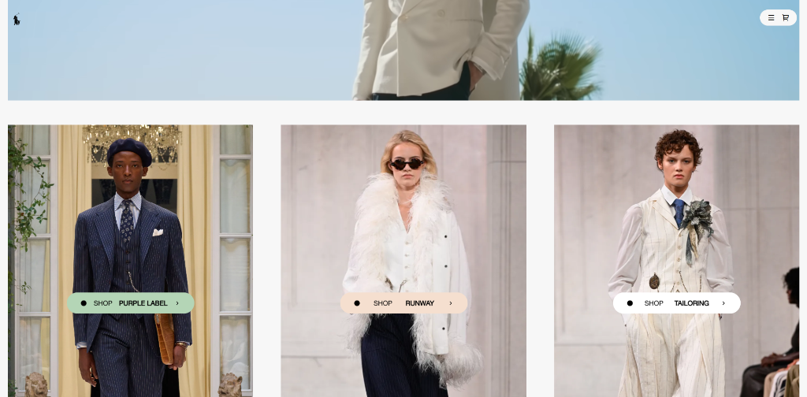
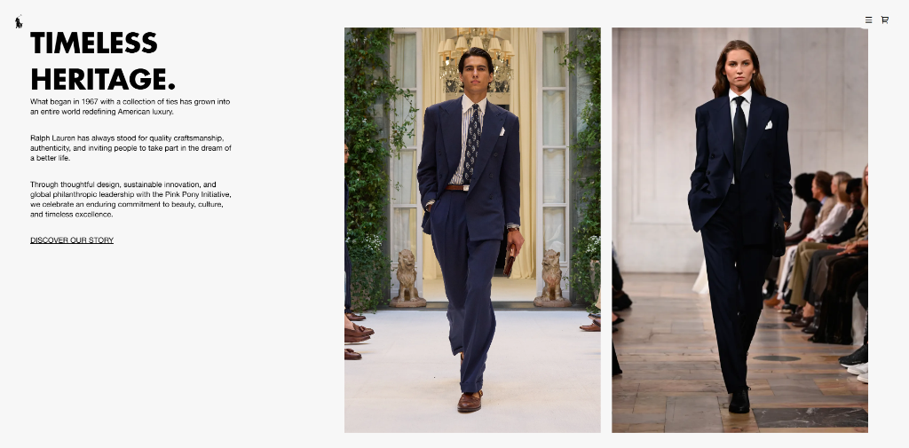

<div align="center">

# RALPH LAUREN
### Luxury Editorial Web Experience & Digital Lookbook

[](https://ralph-lauren-experience.vercel.app)
[](https://github.com/aanasmahfouz/ralph-lauren-experience)
[](https://greensock.com/gsap/)
[](https://developer.mozilla.org/en-US/docs/Web/HTML)
[](https://developer.mozilla.org/en-US/docs/Web/CSS)
[](https://developer.mozilla.org/en-US/docs/Web/JavaScript)

<p align="center">
  An Awwwards-inspired, high-fashion digital editorial experience celebrating the timeless luxury, tailoring, and heritage of <strong>Ralph Lauren</strong>. Built with fluid typography, inertia-based smooth scrolling, and bespoke micro-interactions.
</p>

[**Explore Live Demo →**](https://ralph-lauren-experience.vercel.app)

---

</div>

## 📸 Visual Showcase & Architecture

<div align="center">

### 01. Hero & Brand Experience
*Minimalist luxury header with bold typographic identity, custom vector Polo icon, and cinematic entrance.*



<br/><br/>

### 02. Interactive Collections & Runway Looks
*Dynamic high-fashion categories featuring Purple Label, Runway, and Tailoring with floating badge triggers and dual-angle fashion product reveals.*



<br/><br/>

### 03. Timeless Heritage & Editorial Narrative
*Editorial narrative with balanced typographic hierarchy, historic craftsmanship storytelling, and couture runway photography.*



</div>

---

## ✨ Key Features & Technical Highlights

- **Luxury Editorial Aesthetic**: Recreated with meticulous attention to whitespace, bold display typography (`Futura Bold`), and refined body type (`Helvetica Now Text`).
- **Smooth Inertial Scrolling**: Integrated **Locomotive Scroll** paired with **GSAP ScrollTrigger** proxy for 60fps smooth scrolling performance across all viewports.
- **Magnetic & Interactive Cursor**: Custom cursor animations that smoothly follow cursor velocity and dynamically expand with contextual badges over interactive cards.
- **Responsive Fluid Layouts**: Fully responsive architecture utilizing modern CSS `clamp()`, `minmax()`, and CSS Grid, ensuring pixel-perfect rendering from mobile (320px) up to ultra-wide 4K screens.
- **Zero-Distortion Transparent Assets**: Transparent luxury product catalog showcases with pure native alpha channels and zero color bleed.
- **Cinematic Media Integration**: Autoplaying background video showcase with responsive aspect ratio containment and touch fallback.

---

## 📁 Repository Structure

```text
ralph-lauren-experience/
├── assets/
│   ├── css/
│   │   └── style.css            # Design system, CSS variables, resets & media queries
│   ├── js/
│   │   └── app.js               # Locomotive Scroll, GSAP choreographies & cursor logic
│   ├── fonts/
│   │   ├── Futura-Bold.ttf      # Primary editorial headline typeface
│   │   └── HelveticaNowText-Regular.ttf # Clean modern body typography
│   ├── images/
│   │   ├── favicon.svg          # Official Ralph Lauren Polo Pony vector mark
│   │   ├── look-1.webp          # High-fashion editorial runway lookbooks
│   │   ├── look-2.webp
│   │   ├── look-3.webp
│   │   ├── look-4.webp
│   │   ├── look-5.webp
│   │   ├── polo_bear_sweater.png       # Transparent luxury product catalog items
│   │   ├── heritage_leather_duffel.png
│   │   ├── ralphs_club_parfum.png
│   │   ├── purple_label_scarf.png
│   │   ├── purple_label_bag.png        # Interactive collection preview cards
│   │   ├── purple_label_hoodie.png
│   │   ├── runway_bag_rl50.png
│   │   ├── runway_clutch.png
│   │   ├── tailoring_jacket.png
│   │   └── tailoring_shirt.png
│   └── videos/
│       └── video.mp4            # Cinematic Ralph Lauren hero film
├── docs/
│   └── screenshots/             # Visual documentation showcase
│       ├── 01-hero-experience.png
│       ├── 02-collections-showcase.png
│       └── 03-timeless-heritage.png
├── index.html                   # Semantic HTML5 document
├── .gitignore                   # Clean version control exclusions
└── README.md                    # Project documentation
```

---

## 🛠️ Tech Stack

| Technology | Purpose |
| :--- | :--- |
| **HTML5** | Semantic structure, accessibility (`aria-*`), optimized meta tags |
| **Vanilla CSS3** | Custom design tokens, CSS Grid, Flexbox, responsive fluid typography |
| **JavaScript (ES6+)** | Dynamic DOM manipulation, mouse event tracking, animation orchestration |
| **GSAP (GreenSock)** | Timeline choreographies, pin scrolling, element reveals |
| **ScrollTrigger** | Scroll-driven animation triggering with Locomotive synchronization |
| **Locomotive Scroll** | Smooth inertial momentum scrolling |
| **Remix Icon** | Clean vector interface icons |

---

## 🚀 Local Development Setup

To run this project locally on your machine:

1. **Clone the repository:**
   ```bash
   git clone https://github.com/aanasmahfouz/ralph-lauren-experience.git
   cd ralph-lauren-experience
   ```

2. **Serve the project:**
   You can open `index.html` directly in your browser, or start a local dev server:
   ```bash
   # Using VS Code Live Server or Python:
   python -m http.server 3000
   
   # Or using npx:
   npx serve .
   ```

3. **View in browser:**
   Navigate to `http://localhost:3000` to experience the website.

---

## 👨‍💻 Author

**Anas Mahfouz**
- GitHub: [@aanasmahfouz](https://github.com/aanasmahfouz)
- Portfolio / Vercel: [aanasmahfouz](https://vercel.com/aanasmahfouz)

---

## 📄 License

This project was crafted for educational and portfolio demonstration purposes. All Ralph Lauren brand assets, trademarks, and imagery belong to **Ralph Lauren Corporation**.
